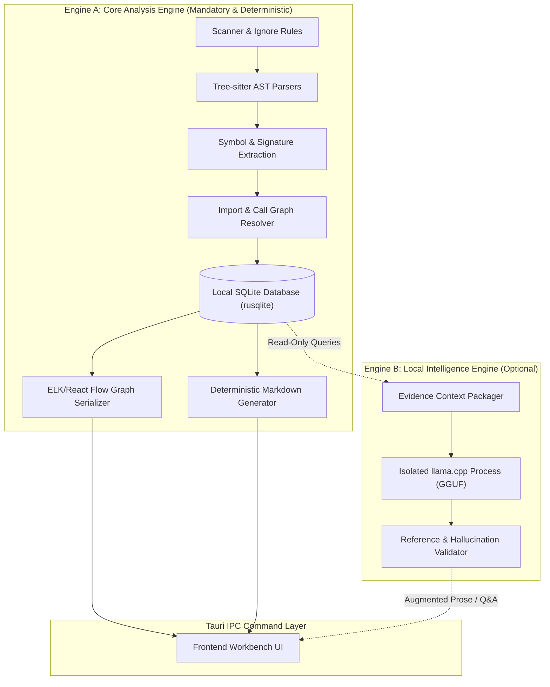

# BuildBuddy Architecture Specification

**Status:** Approved Architectural Blueprint  
**Reference:** [PRD.md](file:///d:/Projects/Vibe%20Code/13_BuildBuddy/docs/PRD.md), [Agents.md](file:///d:/Projects/Vibe%20Code/13_BuildBuddy/Agents.md)  
**Target Version:** BuildBuddy 1.0 (Local-First Desktop Application)

---

## 1. High-Level Architectural Vision

BuildBuddy is a local-first software comprehension workbench. It parses, indexes, graphs, and explains codebases without requiring internet connectivity or executing untrusted user code.

```
+-----------------------------------------------------------------------------------+
|                                 TAURI 2 SHELL                                    |
|                                                                                   |
|  +-----------------------------------------------------------------------------+  |
|  |                       FRONTEND (React + TS + Vite)                          |  |
|  |  [Project Selector] [Explorer] [Architecture/Graphs] [Docs] [Code Viewer]  |  |
|  |  - Radix UI Primitives  - Tailwind Design Tokens  - TanStack Table          |  |
|  |  - React Flow + ELK.js  - CodeMirror 6 / Monaco Viewer                       |  |
|  +---------------------------------------^-------------------------------------+  |
|                                          | Tauri IPC (Typed Commands & Events)    |
|  +---------------------------------------v-------------------------------------+  |
|  |                       RUST BACKEND (src-tauri)                              |  |
|  |                                                                             |  |
|  |  +-----------------------------------------------------------------------+  |  |
|  |  |                 ENGINE A: CORE ANALYSIS ENGINE                        |  |  |
|  |  |                 (100% Deterministic, Offline, Non-LLM)                |  |  |
|  |  |  +------------+  +------------+  +-------------+  +---------------+  |  |  |
|  |  |  |  Scanner   |  |   Parser   |  |   Symbols   |  |  Dep & Call   |  |  |  |
|  |  |  | (Ignore,   |->| (Tree-     |->| (Extraction,|->|     Graph     |  |  |  |
|  |  |  |  Hashing)  |  |  sitter)   |  |  Provenance)|  | (Resolution)  |  |  |  |
|  |  |  +------------+  +------------+  +-------------+  +---------------+  |  |  |
|  |  |         |               |               |                 |          |  |  |
|  |  |         v               v               v                 v          |  |  |
|  |  |  +-----------------------------------------------------------------+  |  |  |
|  |  |  |             PERSISTENCE LAYER (SQLite + FTS5 / rusqlite)        |  |  |  |
|  |  |  |  - Relational Schema  - Provenance Log  - FTS5 Code Index        |  |  |  |
|  |  |  +-----------------------------------------------------------------+  |  |  |
|  |  |         |                                                            |  |  |
|  |  |         v                                                            |  |  |
|  |  |  +----------------------------------+                                |  |  |
|  |  |  | Rule-Based DocGen & Diagram JSON |                                |  |  |
|  |  |  | (HLD, LLD, ADRs, ELK Graph Models)|                                |  |  |
|  |  |  +----------------------------------+                                |  |  |
|  |  +-----------------------------------------------------------------------+  |  |
|  |                                        ^                                    |  |
|  |                                        | Read-Only Query Facade             |  |
|  |  +-------------------------------------|---------------------------------+  |  |
|  |  |                 ENGINE B: LOCAL INTELLIGENCE ENGINE                   |  |  |
|  |  |                 (OPTIONAL, Decoupled Sidecar / Plugin)                |  |  |
|  |  |  - Managed llama.cpp / GGUF Process (Localhost IPC / Unix Socket)     |  |  |
|  |  |  - Retrieval & Prompt Context Packager                                |  |  |
|  |  |  - Natural-Language Q&A & Prose Polishing                              |  |  |
|  |  |  * Zero compile or runtime dependency from Engine A to Engine B        |  |  |
|  |  +-----------------------------------------------------------------------+  |  |
|  +-----------------------------------------------------------------------------+  |
+-----------------------------------------------------------------------------------+
```

---

## 2. Repository Layout

BuildBuddy follows a unified workspace layout combining the Tauri 2 Rust desktop backend and the React frontend:

```text
13_BuildBuddy/
├── .github/                      # CI workflows (format, clippy, vitest, cargo test)
├── docs/                         # Engineering specifications & ADRs
│   ├── PRD.md                    # Product Requirements Document
│   ├── ARCHITECTURE.md           # This document
│   ├── DATA_MODEL.md             # SQLite DDL, indexing, and FTS5 schema
│   ├── DESIGN_TOKENS.md          # Visual tokens (colors, typography, spacing)
│   ├── MVP_PLAN.md               # 9-step sequential implementation roadmap
│   ├── LANGUAGE_SCOPE.md         # TypeScript/JS & Python Tree-sitter contract
│   └── adr/                      # Architecture Decision Records
│       └── 0001-sqlite-local-storage.md
├── fixtures/                     # Deterministic test codebases for golden tests
│   ├── ts-sample-project/        # TypeScript/React test fixture
│   └── py-sample-project/        # Python/FastAPI test fixture
├── src/                          # Frontend Application (React 19 + TypeScript + Vite)
│   ├── assets/                   # Static icons and fonts
│   ├── components/               # React components (Radix primitives + Tailwind)
│   │   ├── ui/                   # Reusable atomic UI (Button, Modal, Input, Badge)
│   │   ├── layout/               # AppShell, TopBar, NavRail, InspectorPanel
│   │   ├── explorer/             # File tree, filter controls, file metadata view
│   │   ├── viewer/               # Code viewer with line highlighting & symbol tags
│   │   ├── graph/                # React Flow canvas, ELK layout runner, minimap
│   │   └── docs/                 # Document tree, markdown editor, ADR manager
│   ├── hooks/                    # Tauri event listeners, store hooks, query hooks
│   ├── stores/                   # State management (project, active file, ui states)
│   ├── lib/                      # Tauri command invocations, ELK graph transforms
│   ├── types/                    # TypeScript interfaces mirroring Rust DTOs
│   ├── index.css                 # Tailwind directives + design token variables
│   ├── App.tsx                   # Main layout container & tab routing
│   └── main.tsx                  # Application entry point
├── src-tauri/                    # Rust Desktop Backend (Tauri 2)
│   ├── Cargo.toml                # Rust workspace / dependencies
│   ├── tauri.conf.json           # Tauri window, capability, and security config
│   ├── icons/                    # App icons
│   ├── migrations/               # Versioned SQL migration files
│   │   ├── 001_initial_schema.sql
│   │   └── 002_fts5_indexes.sql
│   └── src/
│       ├── main.rs               # Application entry point & Tauri builder
│       ├── lib.rs                # Core library root & command registration
│       ├── commands/             # Tauri IPC handler modules
│       │   ├── mod.rs
│       │   ├── project.rs        # Open folder, workspace state, history
│       │   ├── scanner.rs        # Scan execution, progress streaming
│       │   ├── explorer.rs       # Directory listing, file content read
│       │   ├── graph.rs          # Graph query endpoints (nodes, edges)
│       │   └── docs.rs           # Deterministic docgen & ADR management
│       ├── core/                 # Engine A: Core Analysis Engine
│       │   ├── mod.rs
│       │   ├── scanner/          # Walkdir, ignore patterns, file classification
│       │   ├── parser/           # Tree-sitter manager, grammar bindings
│       │   │   ├── mod.rs
│       │   │   ├── typescript.rs
│       │   │   └── python.rs
│       │   ├── symbols/          # Symbol extractor, signatures, scopes
│       │   ├── graph/            # Import resolver, call graph builder
│       │   ├── store/            # SQLite connection, queries, migrations
│       │   │   ├── mod.rs
│       │   │   ├── schema.rs
│       │   │   ├── projects.rs
│       │   │   ├── files.rs
│       │   │   ├── symbols.rs
│       │   │   ├── graph_edges.rs
│       │   │   └── search.rs     # FTS5 full-text queries
│       │   └── docgen/           # Deterministic HLD/LLD/ADR generator
│       └── intelligence/         # Engine B: Optional Local Intelligence Engine
│           ├── mod.rs
│           ├── runtime.rs        # llama.cpp process supervisor
│           └── rag.rs            # Evidence retrieval & context packager
├── package.json                  # Frontend dependencies and build scripts
├── tsconfig.json                 # TypeScript compiler configuration
├── vite.config.ts                # Vite build and Tauri dev server setup
└── tailwind.config.ts            # Tailwind config using custom design tokens
```

---

## 3. Rust Crate & Module Layout (src-tauri)

Per `Agents.md`, backend responsibilities are strictly decomposed into isolated modules with single concerns:

```text
src-tauri/src/
├── core/
│   ├── scanner/
│   │   ├── walker.rs             # Safe filesystem traversal (symlink protection)
│   │   ├── ignore.rs             # .gitignore + .buildbuddyignore parser
│   │   ├── classifier.rs         # File type & language identification
│   │   └── hasher.rs             # BLAKE3/SHA256 incremental change detection
│   ├── parser/
│   │   ├── traits.rs             # LanguageParser trait definition
│   │   ├── manager.rs            # Parser registry and language dispatch
│   │   ├── typescript.rs         # Tree-sitter TS/JS AST visitor
│   │   └── python.rs             # Tree-sitter Python AST visitor
│   ├── symbols/
│   │   ├── model.rs              # Symbol, Function, Class, Interface DTOs
│   │   ├── extractor.rs          # AST-to-Symbol mapping with exact line bounds
│   │   └── provenance.rs         # SourceEvidence constructor & confidence tags
│   ├── graph/
│   │   ├── resolver.rs           # Module path to file ID resolution
│   │   ├── imports.rs            # File-to-file import relationship builder
│   │   ├── calls.rs              # Caller-to-callee call graph builder
│   │   └── topology.rs           # Cycle detection & module coupling metrics
│   ├── store/
│   │   ├── connection.rs         # SQLite connection manager (WAL, PRAGMAs)
│   │   ├── migrations.rs         # Embedded SQL migration executor
│   │   ├── projects.rs           # Project metadata and version CRUD
│   │   ├── files.rs              # File metadata & inventory batch insertion
│   │   ├── symbols.rs            # Symbol table queries & lookups
│   │   ├── relationships.rs      # Edges (imports, calls, dependencies)
│   │   └── fts.rs                # FTS5 search queries & ranking
│   └── docgen/
│       ├── templates.rs          # Engineering document structures
│       ├── overview.rs           # Summary generator from database facts
│       ├── hld.rs                # High-Level Design document generator
│       ├── lld.rs                # Low-Level Design document generator
│       └── adr.rs                # Numbered ADR scaffold and validator
├── intelligence/                 # Engine B (Isolated Subsystem)
│   ├── client.rs                 # Local IPC / HTTP client to llama.cpp
│   ├── process.rs                # Background process lifecycle supervisor
│   ├── context.rs                # Bounded evidence prompt assembly
│   └── validator.rs              # Verifies model claims against SQLite evidence
└── commands/                     # Tauri IPC entry points
    ├── project.rs                # open_project, get_project_state
    ├── scan.rs                   # run_scan, cancel_scan
    ├── explorer.rs               # get_file_tree, read_file_content
    ├── graph.rs                  # get_dependency_graph, get_call_graph
    ├── docs.rs                   # generate_doc, save_adr, export_markdown
    └── intelligence.rs           # ask_project_question, get_model_status
```

---

## 4. Decoupling Engine A and Engine B

The PRD mandates that **Engine A (Core Analysis Engine)** must remain 100% independent of **Engine B (Local Intelligence Engine)**.

### Architectural Boundary Rules
1. **Zero Dependency Inversion:** `core` never imports from `intelligence`. `core` compiles and runs as a standalone library even if `intelligence` is completely omitted.
2. **Deterministic Baseline:** All symbol extractions, graph links, metrics, architectural summaries, and initial HLD/LLD/ADR documents are derived purely from Tree-sitter ASTs and SQLite relational data.
3. **Consumer Role Only:** Engine B operates strictly as a consumer of Engine A's data. It queries SQLite via read-only interfaces to construct prompt packages.
4. **No Direct Metadata Writing:** Engine B cannot alter SQLite core symbol tables or graph edges. Any AI-generated explanations are marked with `confidence = 'inferred'` and stored in dedicated explanation tables.
5. **Independent Process Isolation:** If local LLM inference is enabled, it runs in a sandboxed, low-priority external child process (`llama.cpp` bound to `127.0.0.1:<session-port>` or a local named pipe), preventing GPU/RAM spikes from crashing the core workbench.



---

## 5. Tauri Command Boundaries (IPC Interface)

All communication between the React frontend and Rust backend occurs over Tauri 2's typed IPC channel with explicit JSON-serializable Data Transfer Objects (DTOs).

### Design Rules for IPC
- **No blocking commands:** Long-running tasks (scanning, parsing, indexing) execute on Tokios background thread pools and stream progress events (`scan:progress`, `parse:progress`).
- **Path isolation & sanitization:** The backend rejects any path outside the active project root (prevents path traversal).
- **Read-only project access:** File reading commands verify file bounds and never write or modify user code.
- **Strong DTO contracts:** Every command has dedicated `Request` and `Response` structs in Rust mirrored in `src/types/ipc.ts`.

### Command Inventory

#### Project Management (`src-tauri/src/commands/project.rs`)
| Command Name | Input | Output | Purpose |
|---|---|---|---|
| `select_project_folder` | None (Native Dialog) | `Option<PathBuf>` | Open native folder selection picker |
| `open_project` | `{ path: String }` | `ProjectSummaryDto` | Initialize workspace & run/load SQLite database |
| `get_recent_projects` | None | `Vec<RecentProjectDto>` | Fetch workspace history |

#### Repository Scanning & Analysis (`src-tauri/src/commands/scan.rs`)
| Command Name | Input | Output | Purpose |
|---|---|---|---|
| `start_project_scan` | `{ project_id: i64, force_full: bool }` | `AnalysisRunId` | Spawn background file scan & index task |
| `cancel_project_scan` | `{ analysis_run_id: i64 }` | `bool` | Signal cancellation token to stop scanner |

*Events Emitted:*
- `scan:progress` -> `{ files_discovered: u32, files_scanned: u32, current_file: String }`
- `parse:progress` -> `{ files_parsed: u32, symbols_extracted: u32, current_file: String }`
- `scan:complete` -> `{ analysis_run_id: i64, duration_ms: u64, total_symbols: u32 }`

#### Repository Explorer & Code Viewer (`src-tauri/src/commands/explorer.rs`)
| Command Name | Input | Output | Purpose |
|---|---|---|---|
| `get_file_tree` | `{ project_id: i64 }` | `Vec<FileTreeNodeDto>` | Fetch directory hierarchy with metadata counts |
| `get_file_details` | `{ file_id: i64 }` | `FileDetailsDto` | Fetch functions, classes, imports, metrics |
| `read_file_content` | `{ file_id: i64 }` | `FileContentDto` | Read UTF-8 source content (bounded to 10MB) |

#### Graph & Architecture Visualization (`src-tauri/src/commands/graph.rs`)
| Command Name | Input | Output | Purpose |
|---|---|---|---|
| `get_dependency_graph` | `{ project_id: i64, filter: GraphFilterDto }` | `GraphDataDto` | Return normalized nodes & edges for React Flow |
| `get_call_graph` | `{ function_id: i64, depth: u32 }` | `CallGraphDataDto` | Return upstream/downstream call hierarchy |
| `get_edge_evidence` | `{ edge_id: i64 }` | `SourceEvidenceDto` | Return file, line range, and code snippet for edge |

#### Documentation & ADRs (`src-tauri/src/commands/docs.rs`)
| Command Name | Input | Output | Purpose |
|---|---|---|---|
| `generate_document` | `{ project_id: i64, doc_type: String }` | `DocumentDto` | Deterministic template-based document generation |
| `save_document_revision` | `{ doc_id: i64, content: String }` | `DocumentRevisionDto`| Store manual user edits without overwriting auto-docs |
| `list_adrs` | `{ project_id: i64 }` | `Vec<AdrSummaryDto>` | Fetch all ADR records in project |
| `create_adr` | `{ project_id: i64, title: String }` | `AdrDetailDto` | Scaffold a new numbered ADR file |
| `export_documentation` | `{ project_id: i64, format: String, target_path: String }` | `ExportResultDto` | Export markdown/HTML/diagrams to disk |

---

## 6. Frontend Folder Layout & Architecture

The frontend is a high-density, keyboard-driven single page application built on Vite, React 19, TypeScript, and Tailwind CSS.

```text
src/
├── assets/                       # Static SVGs, branding icons
├── components/
│   ├── ui/                       # Design token primitives (no external styling library)
│   │   ├── Button.tsx            # Flat, restrained button with active states
│   │   ├── Input.tsx             # Monospace-friendly input field
│   │   ├── Badge.tsx             # Status tag (confirmed, static, inferred, unknown)
│   │   ├── SplitPane.tsx         # Resizable multi-column splitter
│   │   ├── ScrollArea.tsx        # Radix-based thin scrollbar
│   │   ├── Tabs.tsx              # Unstyled accessible tab strip
│   │   └── Tooltip.tsx           # Instant engineering hover tooltips
│   ├── layout/
│   │   ├── AppShell.tsx          # Top bar, nav rail, main content, inspector split
│   │   ├── TopBar.tsx            # Project switcher, branch name, scan status, search
│   │   ├── NavRail.tsx           # Vertical nav: Overview, Explorer, Graph, Docs
│   │   ├── StatusBar.tsx         # SQLite state, memory usage, background indexing
│   │   └── InspectorPanel.tsx    # Collapsible right-hand provenance & details panel
│   ├── explorer/
│   │   ├── FileTree.tsx          # Virtualized tree list (TanStack Virtual)
│   │   ├── FileTreeNode.tsx      # Directory/File row with language badges & metrics
│   │   └── FileFilterBar.tsx     # Quick search and language toggle pills
│   ├── viewer/
│   │   ├── CodeViewer.tsx        # CodeMirror 6 or Monaco container
│   │   ├── LineGutter.tsx        # Line numbers + symbol indicator dots
│   │   └── ProvenanceHighlighter.tsx # Highlights exact evidence ranges
│   ├── graph/
│   │   ├── GraphCanvas.tsx       # React Flow canvas wrapper
│   │   ├── ElkLayoutWorker.ts    # Web Worker running ELK.js layered layout
│   │   ├── nodes/                # Custom React Flow nodes (ModuleNode, FileNode)
│   │   ├── edges/                # Custom edges with relationship labels & arrows
│   │   └── GraphControls.tsx     # Zoom, Fit, Layout Direction, Filter by type
│   └── docs/
│       ├── DocNavigation.tsx     # Table of contents & document picker
│       ├── MarkdownPreview.tsx   # GitHub-flavored markdown renderer
│       ├── AdrEditor.tsx         # Side-by-side ADR editor with source links
│       └── StaleIndicator.tsx    # Alerts user when code changes invalidate doc
├── hooks/
│   ├── useProject.ts             # Active project state & folder switcher
│   ├── useScanEvents.ts          # Tauri listener for scan/parse progress events
│   ├── useFileTree.ts            # Query & cache directory hierarchy
│   ├── useGraphLayout.ts         # Hook interfacing with ElkLayoutWorker
│   └── useKeyboardShortcuts.ts   # Command palette and view switching shortcuts
├── stores/
│   ├── projectStore.ts           # Active project ID, root path, scan status
│   ├── explorerStore.ts          # Selected file ID, expanded folder paths
│   └── uiStore.ts                # Active view tab, theme (dark/light), panel widths
├── lib/
│   ├── tauri.ts                  # Typed wrapper around @tauri-apps/api/core invoke
│   ├── elk.ts                    # ELK graph configuration & node dimensions
│   └── formatters.ts             # Byte sizing, line count formatting, timestamp
└── types/
    ├── ipc.ts                    # TypeScript types matching Rust DTOs
    ├── graph.ts                  # React Flow node & edge data interfaces
    └── tokens.ts                 # Design token interfaces
```

---

## 7. Security and Sandboxing Architecture

To comply with the strict non-destructive principles of `Agents.md` and `PRD.md`:
1. **Never Execute Target Code:** BuildBuddy never executes project scripts (`npm install`, `python setup.py`, `cargo check`). All parsing is purely static syntax-tree inspection via Tree-sitter.
2. **Read-Only Enforced at Backend:** The Rust scanner and reader modules open project files with `read_only = true` file descriptors. No file modification APIs exist in the core analysis commands.
3. **Symlink Confinement:** The filesystem traversal checks canonical paths. Any symlink pointing outside the active project root directory is ignored to prevent reading sensitive host files (`/etc/passwd`, user SSH keys).
4. **Secret Sanitization:** Static analysis rules detect potential API keys and tokens. The database and UI redact discovered secret values before displaying them (`sk-proj-****`).
5. **No Network Access in Core:** Engine A creates no outbound socket connections. Tauri CSP headers block external HTTP requests, fonts, and CDN scripts.

