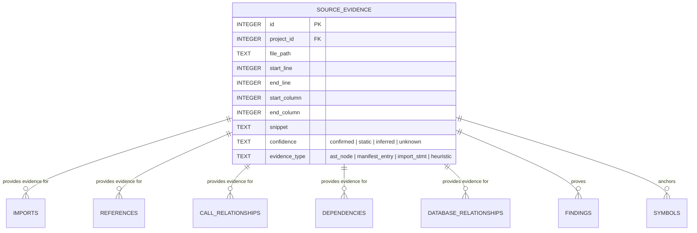

# BuildBuddy Data Model & SQLite Schema

**Status:** Approved Data Specification  
**Reference:** [PRD.md Section 9.4](file:///d:/Projects/Vibe%20Code/13_BuildBuddy/docs/PRD.md#L978-L1010), [Agents.md](file:///d:/Projects/Vibe%20Code/13_BuildBuddy/Agents.md)  
**Database Engine:** SQLite 3 (via `rusqlite` with `bundled` and `fts5` features enabled)

---

## 1. Provenance & Evidence Model

Per `Agents.md` Hard Rule 3:
> "Every relationship/finding stores provenance (file, line range, evidence type). Label results as: confirmed | static | inferred | unknown."

In this schema:
1. `source_evidence` is the single source of truth for code provenance.
2. Every edge table (`imports`, `references`, `call_relationships`, `dependencies`, `database_relationships`) and structural element explicitly holds a non-null `source_evidence_id` foreign key.
3. Edges cannot exist without traceable physical evidence in user source code or manifest files.



---

## 2. Database Pragmas & Configuration

When initializing connections through `rusqlite`, BuildBuddy applies these PRAGMAs:

```sql
PRAGMA foreign_keys = ON;
PRAGMA journal_mode = WAL;
PRAGMA synchronous = NORMAL;
PRAGMA busy_timeout = 5000;
PRAGMA temp_store = MEMORY;
PRAGMA cache_size = -64000; -- 64MB cache
```

---

## 3. Relational Schema DDL

```sql
-- ============================================================================
-- 1. PROJECT & WORKSPACE MANAGEMENT
-- ============================================================================

CREATE TABLE IF NOT EXISTS projects (
    id INTEGER PRIMARY KEY AUTOINCREMENT,
    name TEXT NOT NULL,
    root_path TEXT NOT NULL UNIQUE,
    created_at DATETIME DEFAULT CURRENT_TIMESTAMP NOT NULL,
    updated_at DATETIME DEFAULT CURRENT_TIMESTAMP NOT NULL,
    settings_json TEXT DEFAULT '{}' NOT NULL
);

CREATE TABLE IF NOT EXISTS analysis_runs (
    id INTEGER PRIMARY KEY AUTOINCREMENT,
    project_id INTEGER NOT NULL REFERENCES projects(id) ON DELETE CASCADE,
    started_at DATETIME DEFAULT CURRENT_TIMESTAMP NOT NULL,
    completed_at DATETIME,
    status TEXT CHECK(status IN ('in_progress', 'completed', 'failed', 'cancelled')) NOT NULL,
    is_incremental INTEGER DEFAULT 0 NOT NULL,
    files_discovered INTEGER DEFAULT 0 NOT NULL,
    files_scanned INTEGER DEFAULT 0 NOT NULL,
    files_parsed INTEGER DEFAULT 0 NOT NULL,
    duration_ms INTEGER,
    error_summary TEXT
);

CREATE TABLE IF NOT EXISTS project_versions (
    id INTEGER PRIMARY KEY AUTOINCREMENT,
    project_id INTEGER NOT NULL REFERENCES projects(id) ON DELETE CASCADE,
    analysis_run_id INTEGER NOT NULL REFERENCES analysis_runs(id) ON DELETE CASCADE,
    git_commit_hash TEXT,
    git_branch TEXT,
    snapshot_timestamp DATETIME DEFAULT CURRENT_TIMESTAMP NOT NULL
);

-- ============================================================================
-- 2. SOURCE PROVENANCE & EVIDENCE
-- ============================================================================

CREATE TABLE IF NOT EXISTS source_evidence (
    id INTEGER PRIMARY KEY AUTOINCREMENT,
    project_id INTEGER NOT NULL REFERENCES projects(id) ON DELETE CASCADE,
    file_path TEXT NOT NULL,
    start_line INTEGER NOT NULL,
    end_line INTEGER NOT NULL,
    start_column INTEGER NOT NULL,
    end_column INTEGER NOT NULL,
    snippet TEXT,
    confidence TEXT CHECK(confidence IN ('confirmed', 'static', 'inferred', 'unknown')) NOT NULL,
    evidence_type TEXT CHECK(evidence_type IN ('ast_node', 'manifest_entry', 'import_stmt', 'call_site', 'type_annotation', 'heuristic')) NOT NULL,
    created_at DATETIME DEFAULT CURRENT_TIMESTAMP NOT NULL
);

CREATE INDEX IF NOT EXISTS idx_source_evidence_lookup 
ON source_evidence(project_id, file_path, start_line);

-- ============================================================================
-- 3. LANGUAGES & FRAMEWORKS
-- ============================================================================

CREATE TABLE IF NOT EXISTS languages (
    id INTEGER PRIMARY KEY AUTOINCREMENT,
    name TEXT NOT NULL UNIQUE,
    category TEXT CHECK(category IN ('programming', 'markup', 'data', 'config')) NOT NULL
);

CREATE TABLE IF NOT EXISTS frameworks (
    id INTEGER PRIMARY KEY AUTOINCREMENT,
    project_id INTEGER NOT NULL REFERENCES projects(id) ON DELETE CASCADE,
    name TEXT NOT NULL,
    version TEXT,
    source_evidence_id INTEGER NOT NULL REFERENCES source_evidence(id) ON DELETE CASCADE,
    created_at DATETIME DEFAULT CURRENT_TIMESTAMP NOT NULL
);

-- ============================================================================
-- 4. FILES & DIRECTORIES
-- ============================================================================

CREATE TABLE IF NOT EXISTS files (
    id INTEGER PRIMARY KEY AUTOINCREMENT,
    project_id INTEGER NOT NULL REFERENCES projects(id) ON DELETE CASCADE,
    relative_path TEXT NOT NULL,
    file_name TEXT NOT NULL,
    extension TEXT,
    language_id INTEGER REFERENCES languages(id) ON DELETE SET NULL,
    size_bytes INTEGER NOT NULL,
    line_count INTEGER DEFAULT 0 NOT NULL,
    function_count INTEGER DEFAULT 0 NOT NULL,
    class_count INTEGER DEFAULT 0 NOT NULL,
    import_count INTEGER DEFAULT 0 NOT NULL,
    content_hash TEXT NOT NULL, -- BLAKE3 / SHA256 for change detection
    status TEXT CHECK(status IN ('pending', 'parsed', 'ignored', 'error', 'unsupported')) NOT NULL,
    last_analysis_run_id INTEGER REFERENCES analysis_runs(id) ON DELETE SET NULL,
    updated_at DATETIME DEFAULT CURRENT_TIMESTAMP NOT NULL,
    UNIQUE(project_id, relative_path)
);

CREATE INDEX IF NOT EXISTS idx_files_project_path ON files(project_id, relative_path);
CREATE INDEX IF NOT EXISTS idx_files_extension ON files(extension);
CREATE INDEX IF NOT EXISTS idx_files_hash ON files(project_id, content_hash);

-- ============================================================================
-- 5. MODULES & CODE STRUCTURE
-- ============================================================================

CREATE TABLE IF NOT EXISTS modules (
    id INTEGER PRIMARY KEY AUTOINCREMENT,
    project_id INTEGER NOT NULL REFERENCES projects(id) ON DELETE CASCADE,
    name TEXT NOT NULL,
    root_directory TEXT NOT NULL,
    module_type TEXT CHECK(module_type IN ('package', 'service', 'library', 'submodule', 'component')) NOT NULL,
    UNIQUE(project_id, root_directory)
);

-- ============================================================================
-- 6. SYMBOLS & CODE ENTITIES
-- ============================================================================

CREATE TABLE IF NOT EXISTS symbols (
    id INTEGER PRIMARY KEY AUTOINCREMENT,
    project_id INTEGER NOT NULL REFERENCES projects(id) ON DELETE CASCADE,
    file_id INTEGER NOT NULL REFERENCES files(id) ON DELETE CASCADE,
    name TEXT NOT NULL,
    kind TEXT CHECK(kind IN ('function', 'method', 'class', 'interface', 'variable', 'constant', 'type_alias', 'module', 'property')) NOT NULL,
    signature TEXT,
    docstring TEXT,
    parent_symbol_id INTEGER REFERENCES symbols(id) ON DELETE CASCADE,
    is_exported INTEGER DEFAULT 0 NOT NULL,
    source_evidence_id INTEGER NOT NULL REFERENCES source_evidence(id) ON DELETE CASCADE,
    created_at DATETIME DEFAULT CURRENT_TIMESTAMP NOT NULL
);

CREATE INDEX IF NOT EXISTS idx_symbols_file ON symbols(file_id);
CREATE INDEX IF NOT EXISTS idx_symbols_name ON symbols(project_id, name);
CREATE INDEX IF NOT EXISTS idx_symbols_kind ON symbols(kind);

CREATE TABLE IF NOT EXISTS functions (
    id INTEGER PRIMARY KEY AUTOINCREMENT,
    symbol_id INTEGER NOT NULL UNIQUE REFERENCES symbols(id) ON DELETE CASCADE,
    file_id INTEGER NOT NULL REFERENCES files(id) ON DELETE CASCADE,
    name TEXT NOT NULL,
    parameters_json TEXT DEFAULT '[]' NOT NULL, -- Array of { name, type, default }
    return_type TEXT,
    is_async INTEGER DEFAULT 0 NOT NULL,
    is_generator INTEGER DEFAULT 0 NOT NULL,
    cyclomatic_complexity INTEGER,
    source_evidence_id INTEGER NOT NULL REFERENCES source_evidence(id) ON DELETE CASCADE
);

CREATE INDEX IF NOT EXISTS idx_functions_file ON functions(file_id);

CREATE TABLE IF NOT EXISTS classes (
    id INTEGER PRIMARY KEY AUTOINCREMENT,
    symbol_id INTEGER NOT NULL UNIQUE REFERENCES symbols(id) ON DELETE CASCADE,
    file_id INTEGER NOT NULL REFERENCES files(id) ON DELETE CASCADE,
    name TEXT NOT NULL,
    superclass_name TEXT,
    interfaces_json TEXT DEFAULT '[]' NOT NULL,
    source_evidence_id INTEGER NOT NULL REFERENCES source_evidence(id) ON DELETE CASCADE
);

CREATE TABLE IF NOT EXISTS interfaces (
    id INTEGER PRIMARY KEY AUTOINCREMENT,
    symbol_id INTEGER NOT NULL UNIQUE REFERENCES symbols(id) ON DELETE CASCADE,
    file_id INTEGER NOT NULL REFERENCES files(id) ON DELETE CASCADE,
    name TEXT NOT NULL,
    extends_json TEXT DEFAULT '[]' NOT NULL,
    source_evidence_id INTEGER NOT NULL REFERENCES source_evidence(id) ON DELETE CASCADE
);

-- ============================================================================
-- 7. GRAPH EDGES & RELATIONSHIPS (ALL REFERENCE SOURCE EVIDENCE)
-- ============================================================================

-- Edge Table 1: File/Module Imports
CREATE TABLE IF NOT EXISTS imports (
    id INTEGER PRIMARY KEY AUTOINCREMENT,
    file_id INTEGER NOT NULL REFERENCES files(id) ON DELETE CASCADE,
    imported_path TEXT NOT NULL,
    resolved_file_id INTEGER REFERENCES files(id) ON DELETE SET NULL,
    imported_symbol TEXT,
    alias TEXT,
    is_type_only INTEGER DEFAULT 0 NOT NULL,
    source_evidence_id INTEGER NOT NULL REFERENCES source_evidence(id) ON DELETE CASCADE
);

CREATE INDEX IF NOT EXISTS idx_imports_source ON imports(file_id);
CREATE INDEX IF NOT EXISTS idx_imports_resolved ON imports(resolved_file_id);

-- Edge Table 2: Symbol References (Usages, Reads, Instantiations)
CREATE TABLE IF NOT EXISTS "references" (
    id INTEGER PRIMARY KEY AUTOINCREMENT,
    symbol_id INTEGER NOT NULL REFERENCES symbols(id) ON DELETE CASCADE,
    referencing_file_id INTEGER NOT NULL REFERENCES files(id) ON DELETE CASCADE,
    reference_type TEXT CHECK(reference_type IN ('call', 'read', 'write', 'type_ref', 'instantiation', 'decorator')) NOT NULL,
    source_evidence_id INTEGER NOT NULL REFERENCES source_evidence(id) ON DELETE CASCADE
);

CREATE INDEX IF NOT EXISTS idx_references_symbol ON "references"(symbol_id);
CREATE INDEX IF NOT EXISTS idx_references_file ON "references"(referencing_file_id);

-- Edge Table 3: Function-to-Function Call Graph Edges
CREATE TABLE IF NOT EXISTS call_relationships (
    id INTEGER PRIMARY KEY AUTOINCREMENT,
    caller_function_id INTEGER NOT NULL REFERENCES functions(id) ON DELETE CASCADE,
    callee_symbol_id INTEGER REFERENCES symbols(id) ON DELETE SET NULL,
    callee_name TEXT NOT NULL,
    is_dynamic INTEGER DEFAULT 0 NOT NULL,
    source_evidence_id INTEGER NOT NULL REFERENCES source_evidence(id) ON DELETE CASCADE
);

CREATE INDEX IF NOT EXISTS idx_call_caller ON call_relationships(caller_function_id);
CREATE INDEX IF NOT EXISTS idx_call_callee ON call_relationships(callee_symbol_id);

-- Edge Table 4: Project Dependencies (Manifest declared)
CREATE TABLE IF NOT EXISTS dependencies (
    id INTEGER PRIMARY KEY AUTOINCREMENT,
    project_id INTEGER NOT NULL REFERENCES projects(id) ON DELETE CASCADE,
    name TEXT NOT NULL,
    version_constraint TEXT,
    resolved_version TEXT,
    is_dev INTEGER DEFAULT 0 NOT NULL,
    package_manager TEXT CHECK(package_manager IN ('npm', 'pnpm', 'yarn', 'pip', 'poetry', 'cargo', 'go_mod', 'other')) NOT NULL,
    manifest_file_id INTEGER REFERENCES files(id) ON DELETE SET NULL,
    source_evidence_id INTEGER NOT NULL REFERENCES source_evidence(id) ON DELETE CASCADE
);

CREATE INDEX IF NOT EXISTS idx_dependencies_project ON dependencies(project_id, name);

-- ============================================================================
-- 8. APIS, DATABASE ENTITIES & STATIC FINDINGS
-- ============================================================================

CREATE TABLE IF NOT EXISTS api_endpoints (
    id INTEGER PRIMARY KEY AUTOINCREMENT,
    project_id INTEGER NOT NULL REFERENCES projects(id) ON DELETE CASCADE,
    file_id INTEGER NOT NULL REFERENCES files(id) ON DELETE CASCADE,
    http_method TEXT NOT NULL,
    route_path TEXT NOT NULL,
    handler_symbol_id INTEGER REFERENCES symbols(id) ON DELETE SET NULL,
    middleware_json TEXT DEFAULT '[]' NOT NULL,
    auth_required INTEGER DEFAULT 0 NOT NULL,
    source_evidence_id INTEGER NOT NULL REFERENCES source_evidence(id) ON DELETE CASCADE
);

CREATE INDEX IF NOT EXISTS idx_api_project ON api_endpoints(project_id, route_path);

CREATE TABLE IF NOT EXISTS database_entities (
    id INTEGER PRIMARY KEY AUTOINCREMENT,
    project_id INTEGER NOT NULL REFERENCES projects(id) ON DELETE CASCADE,
    file_id INTEGER NOT NULL REFERENCES files(id) ON DELETE CASCADE,
    name TEXT NOT NULL,
    table_name TEXT,
    orm_type TEXT CHECK(orm_type IN ('prisma', 'typeorm', 'sqlalchemy', 'diesel', 'sqlx', 'raw_sql', 'other')) NOT NULL,
    source_evidence_id INTEGER NOT NULL REFERENCES source_evidence(id) ON DELETE CASCADE
);

CREATE TABLE IF NOT EXISTS database_fields (
    id INTEGER PRIMARY KEY AUTOINCREMENT,
    entity_id INTEGER NOT NULL REFERENCES database_entities(id) ON DELETE CASCADE,
    name TEXT NOT NULL,
    column_name TEXT,
    data_type TEXT NOT NULL,
    is_primary_key INTEGER DEFAULT 0 NOT NULL,
    is_nullable INTEGER DEFAULT 0 NOT NULL,
    is_unique INTEGER DEFAULT 0 NOT NULL,
    source_evidence_id INTEGER NOT NULL REFERENCES source_evidence(id) ON DELETE CASCADE
);

-- Edge Table 5: Entity-to-Entity Database Relations
CREATE TABLE IF NOT EXISTS database_relationships (
    id INTEGER PRIMARY KEY AUTOINCREMENT,
    source_entity_id INTEGER NOT NULL REFERENCES database_entities(id) ON DELETE CASCADE,
    target_entity_id INTEGER NOT NULL REFERENCES database_entities(id) ON DELETE CASCADE,
    relationship_type TEXT CHECK(relationship_type IN ('one_to_one', 'one_to_many', 'many_to_many')) NOT NULL,
    foreign_key_field_id INTEGER REFERENCES database_fields(id) ON DELETE SET NULL,
    source_evidence_id INTEGER NOT NULL REFERENCES source_evidence(id) ON DELETE CASCADE
);

CREATE TABLE IF NOT EXISTS findings (
    id INTEGER PRIMARY KEY AUTOINCREMENT,
    project_id INTEGER NOT NULL REFERENCES projects(id) ON DELETE CASCADE,
    file_id INTEGER NOT NULL REFERENCES files(id) ON DELETE CASCADE,
    rule_id TEXT NOT NULL,
    category TEXT CHECK(category IN ('dead_code', 'unused_import', 'circular_dependency', 'excessive_complexity', 'security_heuristic', 'missing_error_handling')) NOT NULL,
    severity TEXT CHECK(severity IN ('info', 'warning', 'error', 'critical')) NOT NULL,
    title TEXT NOT NULL,
    description TEXT NOT NULL,
    source_evidence_id INTEGER NOT NULL REFERENCES source_evidence(id) ON DELETE CASCADE,
    created_at DATETIME DEFAULT CURRENT_TIMESTAMP NOT NULL
);

CREATE INDEX IF NOT EXISTS idx_findings_project ON findings(project_id, category);

-- ============================================================================
-- 9. DIAGRAMS & DOCUMENTATION REVISIONS
-- ============================================================================

CREATE TABLE IF NOT EXISTS diagrams (
    id INTEGER PRIMARY KEY AUTOINCREMENT,
    project_id INTEGER NOT NULL REFERENCES projects(id) ON DELETE CASCADE,
    diagram_type TEXT CHECK(diagram_type IN ('architecture', 'dependency', 'call_graph', 'er_diagram', 'sequence')) NOT NULL,
    title TEXT NOT NULL,
    model_json TEXT NOT NULL, -- Structured JSON (nodes, edges, groups)
    layout_engine TEXT DEFAULT 'elk' NOT NULL,
    created_at DATETIME DEFAULT CURRENT_TIMESTAMP NOT NULL,
    updated_at DATETIME DEFAULT CURRENT_TIMESTAMP NOT NULL
);

CREATE TABLE IF NOT EXISTS documents (
    id INTEGER PRIMARY KEY AUTOINCREMENT,
    project_id INTEGER NOT NULL REFERENCES projects(id) ON DELETE CASCADE,
    doc_type TEXT CHECK(doc_type IN ('overview', 'hld', 'lld', 'adr', 'api', 'database', 'security', 'tech_debt')) NOT NULL,
    title TEXT NOT NULL,
    slug TEXT NOT NULL,
    target_file_path TEXT,
    created_at DATETIME DEFAULT CURRENT_TIMESTAMP NOT NULL,
    updated_at DATETIME DEFAULT CURRENT_TIMESTAMP NOT NULL,
    UNIQUE(project_id, slug)
);

CREATE TABLE IF NOT EXISTS document_revisions (
    id INTEGER PRIMARY KEY AUTOINCREMENT,
    document_id INTEGER NOT NULL REFERENCES documents(id) ON DELETE CASCADE,
    revision_number INTEGER NOT NULL,
    content_markdown TEXT NOT NULL,
    is_user_edited INTEGER DEFAULT 0 NOT NULL,
    created_at DATETIME DEFAULT CURRENT_TIMESTAMP NOT NULL,
    UNIQUE(document_id, revision_number)
);

CREATE INDEX IF NOT EXISTS idx_doc_rev_order ON document_revisions(document_id, revision_number DESC);
```

---

## 4. Full-Text Search (SQLite FTS5)

SQLite FTS5 is configured to provide sub-millisecond search across symbols, files, and generated documents.

```sql
-- FTS5 Index for Symbols & Signatures
CREATE VIRTUAL TABLE IF NOT EXISTS fts_symbols USING fts5(
    symbol_id UNINDEXED,
    name,
    signature,
    docstring,
    file_path,
    tokenize = 'porter unicode61'
);

-- FTS5 Index for Repository Files
CREATE VIRTUAL TABLE IF NOT EXISTS fts_files USING fts5(
    file_id UNINDEXED,
    relative_path,
    file_name,
    tokenize = 'porter unicode61'
);

-- FTS5 Index for Documentation & ADRs
CREATE VIRTUAL TABLE IF NOT EXISTS fts_documents USING fts5(
    document_id UNINDEXED,
    title,
    content_markdown,
    tokenize = 'porter unicode61'
);
```

---

## 5. FTS5 Synchronization Triggers

Automated database triggers guarantee that FTS5 search indexes remain strictly consistent with primary relational tables:

```sql
-- Trigger: Symbol Insert Sync
CREATE TRIGGER IF NOT EXISTS trg_symbols_ai AFTER INSERT ON symbols
BEGIN
    INSERT INTO fts_symbols (symbol_id, name, signature, docstring, file_path)
    SELECT 
        NEW.id, 
        NEW.name, 
        NEW.signature, 
        NEW.docstring, 
        f.relative_path
    FROM files f WHERE f.id = NEW.file_id;
END;

-- Trigger: Symbol Delete Sync
CREATE TRIGGER IF NOT EXISTS trg_symbols_ad AFTER DELETE ON symbols
BEGIN
    DELETE FROM fts_symbols WHERE symbol_id = OLD.id;
END;

-- Trigger: Symbol Update Sync
CREATE TRIGGER IF NOT EXISTS trg_symbols_au AFTER UPDATE ON symbols
BEGIN
    DELETE FROM fts_symbols WHERE symbol_id = OLD.id;
    INSERT INTO fts_symbols (symbol_id, name, signature, docstring, file_path)
    SELECT 
        NEW.id, 
        NEW.name, 
        NEW.signature, 
        NEW.docstring, 
        f.relative_path
    FROM files f WHERE f.id = NEW.file_id;
END;

-- Trigger: Document Revision Sync
CREATE TRIGGER IF NOT EXISTS trg_doc_rev_ai AFTER INSERT ON document_revisions
BEGIN
    DELETE FROM fts_documents WHERE document_id = NEW.document_id;
    INSERT INTO fts_documents (document_id, title, content_markdown)
    SELECT 
        d.id,
        d.title,
        NEW.content_markdown
    FROM documents d WHERE d.id = NEW.document_id;
END;

-- Trigger: File Insert Sync
CREATE TRIGGER IF NOT EXISTS trg_files_ai AFTER INSERT ON files
BEGIN
    INSERT INTO fts_files (file_id, relative_path, file_name)
    VALUES (NEW.id, NEW.relative_path, NEW.file_name);
END;

-- Trigger: File Delete Sync
CREATE TRIGGER IF NOT EXISTS trg_files_ad AFTER DELETE ON files
BEGIN
    DELETE FROM fts_files WHERE file_id = OLD.id;
END;
```

