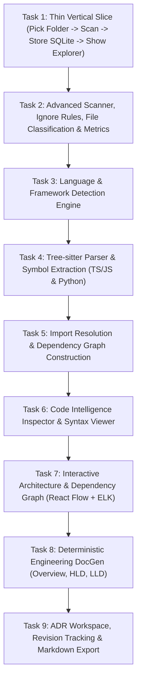

# BuildBuddy MVP Implementation Plan

**Status:** Approved MVP Roadmap  
**Reference:** [PRD.md Section 15 (MVP Scope)](file:///d:/Projects/Vibe%20Code/13_BuildBuddy/docs/PRD.md#L1314-L1338), [Agents.md](file:///d:/Projects/Vibe%20Code/13_BuildBuddy/Agents.md)  
**Execution Strategy:** Sequential incremental delivery starting with a thin vertical slice. No application code is written before task assignment.

---

## Roadmap Overview

---

## Task 1: Scaffolding & Thin Vertical Slice

### Goal
Establish the working Tauri 2 desktop application and deliver the initial vertical slice: user clicks "Open Folder", selects a repository via native dialog, the backend traverses the directory, records file paths in SQLite, and the frontend renders the flat directory list in the Explorer panel.

### Files Touched
- `package.json`, `vite.config.ts`, `tsconfig.json`, `tailwind.config.ts`
- `src-tauri/Cargo.toml`, `src-tauri/tauri.conf.json`, `src-tauri/src/main.rs`, `src-tauri/src/lib.rs`
- `src-tauri/src/core/store/connection.rs`, `src-tauri/src/core/store/migrations.rs`
- `src-tauri/src/core/store/projects.rs`, `src-tauri/src/core/store/files.rs`
- `src-tauri/src/commands/project.rs`, `src-tauri/src/commands/explorer.rs`
- `src/App.tsx`, `src/components/layout/AppShell.tsx`, `src/components/explorer/FileTree.tsx`
- `src/lib/tauri.ts`, `src/types/ipc.ts`

### Acceptance Criteria
1. Running `npm run tauri dev` boots the desktop application on Windows and macOS.
2. Clicking "Open Project" triggers Tauri native folder picker (`tauri-plugin-dialog`).
3. Selecting a folder creates a project record in local SQLite database (`buildbuddy.db` in app data).
4. Files in the root directory are recorded in the `files` table with relative paths and sizes.
5. Frontend Explorer panel displays the scanned file list.
6. Opening a previously scanned folder reloads records from SQLite without duplicate entries.

### Tests Required
- `cargo test --lib core::store::projects`: verify project creation and duplicate path handling.
- `cargo test --lib core::store::files`: verify batch file insertion into SQLite.
- Frontend Vitest: test `FileTree.tsx` renders file rows when provided mock IPC DTOs.

---

## Task 2: Advanced Scanner, Ignore Rules, File Classification & Metrics

### Goal
Enhance the scanner with proper recursive traversal, `.gitignore` and `.buildbuddyignore` respect, file content hashing (BLAKE3/SHA256) for incremental analysis, line counting, and virtualized tree rendering.

### Files Touched
- `src-tauri/src/core/scanner/walker.rs`
- `src-tauri/src/core/scanner/ignore.rs`
- `src-tauri/src/core/scanner/hasher.rs`
- `src-tauri/src/commands/scan.rs`
- `src/components/explorer/FileTree.tsx`
- `src/components/explorer/FileTreeNode.tsx`
- `src/components/explorer/FileFilterBar.tsx`
- `src/hooks/useScanEvents.ts`

### Acceptance Criteria
1. Scanner honors `.gitignore`, ignoring `node_modules`, `.git`, `dist`, `target`, `__pycache__`, and `.venv`.
2. Symlinks pointing outside the project root are ignored to prevent path traversal.
3. Scanner streams progress events (`scan:progress`) to the UI during traversal.
4. Total lines of code and file byte sizes are calculated accurately.
5. Explorer UI displays a collapsible directory tree using TanStack Virtual for instant scrolling over 10,000+ files.
6. Re-scanning an unchanged repository finishes in <500ms using file hashes.

### Tests Required
- Unit test `ignore.rs`: verify ignore patterns against test directory paths.
- Unit test `walker.rs`: verify symlink containment and non-traversal.
- Integration test: scan `fixtures/ts-sample-project` and assert exact file count matches expected manifest.

---

## Task 3: Language & Framework Detection Engine

### Goal
Classify every file by programming language and detect project-level frameworks using manifest evidence (e.g. `package.json`, `requirements.txt`, `pyproject.toml`) and source heuristics.

### Files Touched
- `src-tauri/src/core/scanner/classifier.rs`
- `src-tauri/src/core/scanner/frameworks.rs`
- `src-tauri/src/core/store/source_evidence.rs`
- `src-tauri/src/commands/project.rs`
- `src/components/layout/TopBar.tsx`
- `src/components/explorer/FileFilterBar.tsx`
- `src/types/ipc.ts`

### Acceptance Criteria
1. Files are correctly categorized into TypeScript, JavaScript, Python, JSON, Markdown, or SQL.
2. Frameworks (React, Next.js, Express, FastAPI, Django, Flask) are detected from package manifests.
3. Every detected framework creates a `source_evidence` record linking to the manifest file and line number.
4. The TopBar displays active language pills and detected frameworks.
5. The Explorer allows filtering files by language (e.g., clicking "TypeScript" shows only `.ts`/`.tsx` files).

### Tests Required
- Unit test `classifier.rs`: test extension and shebang classification.
- Unit test `frameworks.rs`: parse sample `package.json` and `requirements.txt` to verify detection accuracy.
- Database test: verify `source_evidence` foreign keys are populated for detected frameworks.

---

## Task 4: Tree-sitter Parser & Symbol Extraction (TS/JS & Python)

### Goal
Integrate Tree-sitter parsers for TypeScript/JavaScript and Python. Extract functions, classes, interfaces, signatures, parameters, and anchor every symbol to `source_evidence` with line numbers and column spans.

### Files Touched
- `src-tauri/Cargo.toml` (add `tree-sitter`, `tree-sitter-typescript`, `tree-sitter-python`)
- `src-tauri/src/core/parser/traits.rs`
- `src-tauri/src/core/parser/manager.rs`
- `src-tauri/src/core/parser/typescript.rs`
- `src-tauri/src/core/parser/python.rs`
- `src-tauri/src/core/symbols/extractor.rs`
- `src-tauri/src/core/store/symbols.rs`
- `src-tauri/src/commands/scan.rs`
- `src/types/ipc.ts`

### Acceptance Criteria
1. Tree-sitter extracts functions, async functions, arrow functions, classes, methods, and interfaces.
2. Signatures, parameter names, and return types are captured.
3. Every extracted symbol generates a `source_evidence` row with exact `(start_line, end_line, start_col, end_col)` and code snippet.
4. Extracted symbols are indexed into SQLite FTS5 (`fts_symbols`).
5. Parser gracefully handles syntax errors in malformed files without terminating the scan.

### Tests Required
- Golden fixture test `typescript_test.rs`: parse `fixtures/ts-sample-project/src/index.ts` and assert exact extracted symbol names and line ranges.
- Golden fixture test `python_test.rs`: parse `fixtures/py-sample-project/main.py` and assert function signatures and class definitions.
- FTS5 test: query `fts_symbols` for a known symbol and verify sub-millisecond retrieval.

---

## Task 5: Import Resolution & Dependency Graph Construction

### Goal
Resolve module imports to concrete files. Build file-to-file and module-to-module dependency graphs with full `source_evidence` provenance for every edge.

### Files Touched
- `src-tauri/src/core/graph/resolver.rs`
- `src-tauri/src/core/graph/imports.rs`
- `src-tauri/src/core/graph/topology.rs`
- `src-tauri/src/core/store/relationships.rs`
- `src-tauri/src/commands/graph.rs`
- `src/types/ipc.ts`

### Acceptance Criteria
1. TypeScript relative imports (`./utils`, `../api/client`) and path aliases (`@/components/*`) resolve to target files.
2. Python relative imports (`from .models import User`) and package imports resolve to files.
3. External package imports (e.g., `react`, `fastapi`) are recorded as external dependencies.
4. Circular dependencies are detected and flagged in the `findings` table.
5. Every import edge points to a `source_evidence_id` referencing the exact `import` line in source.

### Tests Required
- Unit test `resolver.rs`: test TS extension resolution (`.ts`, `.tsx`, `/index.ts`) and Python package resolution.
- Unit test `topology.rs`: assert cycle detection on a synthetic cyclic graph fixture.
- Database test: verify cascading deletes remove import edges when a file is deleted.

---

## Task 6: Code Intelligence Inspector & Syntax Viewer

### Goal
Implement the central code viewer and right-hand inspector panel. Selecting any file in the Explorer displays its formatted source code, symbol outlines, outgoing imports, incoming references, and metrics.

### Files Touched
- `src-tauri/src/commands/explorer.rs`
- `src/components/viewer/CodeViewer.tsx`
- `src/components/viewer/LineGutter.tsx`
- `src/components/layout/InspectorPanel.tsx`
- `src/components/ui/Badge.tsx`
- `src/stores/explorerStore.ts`

### Acceptance Criteria
1. Clicking a file loads content safely (bounded to 10MB) into the code viewer with line numbers.
2. Clicking a line or symbol highlights its range and displays provenance metadata in the Inspector.
3. Inspector shows: functions, classes, imports, and referencing files.
4. Status badges (`confirmed`, `static`, `inferred`, `unknown`) are displayed alongside each relationship.
5. Clicking an imported file or reference in the Inspector navigates immediately to that file and line.

### Tests Required
- Backend test: `read_file_content` returns an error if attempting to access a path outside the project root.
- Frontend test: `InspectorPanel.tsx` displays symbol details when selected.
- E2E Playwright test: click file in tree -> code loads in viewer -> symbol click updates inspector.

---

## Task 7: Interactive Architecture & Dependency Graph Canvas

### Goal
Provide a full-canvas interactive dependency graph using React Flow and an ELK.js layout web worker. Users can inspect file and module connections, filter relationship types, and jump to code.

### Files Touched
- `src-tauri/src/commands/graph.rs`
- `src/components/graph/GraphCanvas.tsx`
- `src/components/graph/ElkLayoutWorker.ts`
- `src/components/graph/nodes/ModuleNode.tsx`
- `src/components/graph/nodes/FileNode.tsx`
- `src/components/graph/edges/DependencyEdge.tsx`
- `src/components/graph/GraphControls.tsx`
- `src/lib/elk.ts`

### Acceptance Criteria
1. React Flow canvas renders files as nodes and imports as clean, orthogonal directed edges.
2. ELK.js runs layered layout calculation in a Web Worker without blocking UI responsiveness.
3. Colors strictly follow `DESIGN_TOKENS.md` (Frontend: blue-grey, Backend: green-grey, Database: amber).
4. Users can zoom, pan, fit to screen, and filter nodes by folder/module.
5. Clicking an edge opens the inspector displaying the exact source line and import statement.

### Tests Required
- Unit test `elk.ts`: verify node and edge transformation from backend DTO to ELK graph model.
- Performance test: layout calculation for 500 nodes completes in <1000ms inside the worker.
- Component test: verify edge click fires selection callback.

---

## Task 8: Deterministic Engineering Documentation Generator (Overview, HLD, LLD)

### Goal
Generate structured, professional technical documentation (Project Overview, High-Level Design, Low-Level Design) strictly from SQLite facts without an LLM.

### Files Touched
- `src-tauri/src/core/docgen/templates.rs`
- `src-tauri/src/core/docgen/overview.rs`
- `src-tauri/src/core/docgen/hld.rs`
- `src-tauri/src/core/docgen/lld.rs`
- `src-tauri/src/commands/docs.rs`
- `src/components/docs/MarkdownPreview.tsx`
- `src/components/docs/DocNavigation.tsx`

### Acceptance Criteria
1. Overview document includes: project purpose, file counts, detected languages, frameworks, and entry points.
2. HLD includes: system context, architecture component breakdown, external dependencies, and Mermaid diagram.
3. LLD includes: per-file module documentation, function signatures, complexity scores, and call lists.
4. Writing style adheres strictly to PRD Section 6.2 (natural technical prose, no filler phrases).
5. Documents are persisted in SQLite `documents` and `document_revisions` tables with FTS5 indexing.

### Tests Required
- Unit test `overview.rs`: generate overview from SQLite fixture and verify absence of banned AI cliches.
- Unit test `hld.rs`: assert Mermaid diagram syntax validity.
- Integration test: verify generated document can be searched via `fts_documents`.

---

## Task 9: ADR Workspace, Revision Tracking & Markdown Export Pipeline

### Goal
Provide ADR management (scaffold numbered ADR, edit markdown, track revisions) and export documentation and diagrams to disk.

### Files Touched
- `src-tauri/src/core/docgen/adr.rs`
- `src-tauri/src/core/docgen/export.rs`
- `src-tauri/src/commands/docs.rs`
- `src/components/docs/AdrEditor.tsx`
- `src/components/docs/StaleIndicator.tsx`
- `src/components/ui/Modal.tsx`

### Acceptance Criteria
1. Users can create a new ADR (e.g. `0001-use-sqlite.md`) following the standard PRD Section 6.1 template.
2. Side-by-side markdown editor allows editing documents with live preview.
3. User edits create a new `document_revisions` entry (`is_user_edited = 1`) without overwriting auto-generated baselines.
4. Documents show a "stale" badge if underlying source files have changed since the document generation date.
5. Users can export documentation as standard `.md` files or Mermaid SVG diagrams to an output directory.

### Tests Required
- Unit test `adr.rs`: verify ADR numbering sequence (`0001`, `0002`) and template schema.
- Backend test: `export_documentation` writes valid UTF-8 markdown files to disk safely.
- Revision test: verify revision history order and non-destructive updates.

